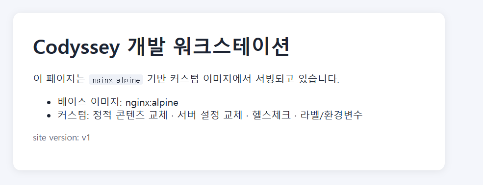
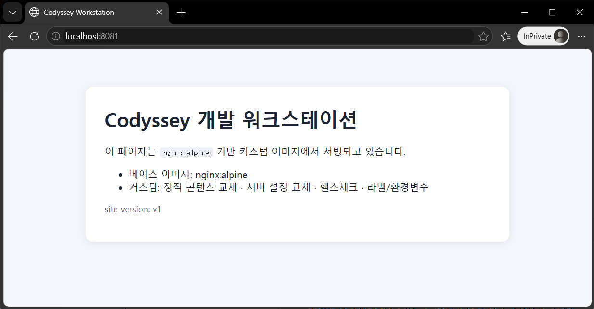
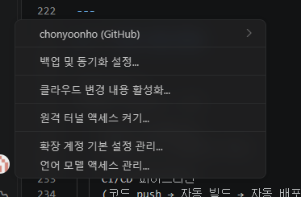
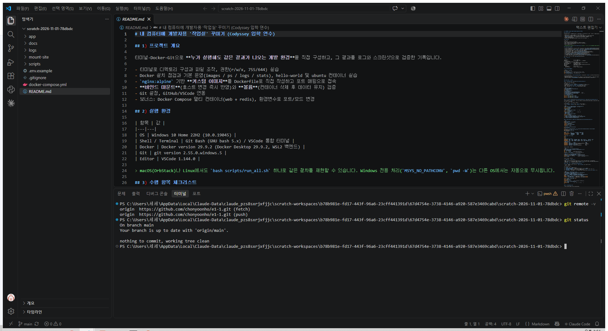

# 내 컴퓨터에 개발자용 '작업실' 꾸미기 (Codyssey 입학 연수)

## 1) 프로젝트 개요

터미널·Docker·Git으로 **누가 실행해도 같은 결과가 나오는 개발 환경**을 직접 구성하고, 그 결과를 로그와 스크린샷으로 검증한 기록입니다.

- 터미널로 디렉토리 구성과 파일 조작, 권한(r/w/x, 755/644) 실습
- Docker 설치 점검과 기본 운영(images / ps / logs / stats), hello-world 및 ubuntu 컨테이너 실습
- `nginx:alpine` 기반 **커스텀 이미지**를 Dockerfile로 직접 작성하고 포트 매핑으로 접속
- **바인드 마운트**(호스트 변경 즉시 반영)와 **볼륨**(컨테이너 삭제 후 데이터 유지) 검증
- Git 설정, GitHub/VSCode 연동
- 보너스: Docker Compose 멀티 컨테이너(web + redis), 환경변수로 포트/모드 변경

## 2) 실행 환경

| 항목 | 값 |
|---|---|
| OS | Windows 10 Home 22H2 (10.0.19045) |
| Shell / Terminal | Git Bash (GNU bash 5.x, 실습 스크립트 실행) / PowerShell (VSCode 통합 터미널) |
| Docker | Docker version 29.9.2 (Docker Desktop 29.9.2, WSL2 백엔드) |
| Git | git version 2.55.0.windows.5 |
| Editor | VSCode 1.144.0 |

> 실제로 실행해 검증한 환경은 위의 Windows 10 한 곳입니다. macOS(OrbStack)나 Linux에서도 같은 절차로 동작하도록 작성했지만(Windows 전용 처리 `MSYS_NO_PATHCONV`, `pwd -W`는 다른 OS에서는 무시됩니다) 직접 실행해 확인하지는 않았습니다.

## 3) 수행 항목 체크리스트

- [x] 터미널 기본 조작 (pwd / ls -la / cd / mkdir / cp / mv / rm / cat / touch) → [logs/01_terminal.txt](logs/01_terminal.txt)
- [x] 권한 변경 실습 (파일 1개 + 디렉토리 1개, 변경 전/후 비교) → [logs/02_permissions.txt](logs/02_permissions.txt)
- [x] Docker 설치/데몬 점검 (`docker --version`, `docker info`) → [logs/03_docker_basics.txt](logs/03_docker_basics.txt)
- [x] Docker 운영 명령 (images / ps -a / logs / stats / stop) → 위와 같음
- [x] hello-world 실행, ubuntu 내부 명령, exec vs attach 비교 → 위와 같음
- [x] Dockerfile 커스텀 이미지 빌드/실행 → [logs/04_build_run.txt](logs/04_build_run.txt)
- [x] 포트 매핑 접속 2회 (8080, 8081) + 브라우저 캡처 → [docs/screenshots/](docs/screenshots)
- [x] 바인드 마운트 변경 반영 → [logs/05_bind_mount.txt](logs/05_bind_mount.txt)
- [x] 볼륨 영속성 (컨테이너 삭제 전/후) → [logs/06_volume.txt](logs/06_volume.txt)
- [x] Git 설정 (`git config --list`) → [logs/07_git.txt](logs/07_git.txt)
- [x] VSCode GitHub 로그인 + 저장소 연동 캡처 → [docs/screenshots/](docs/screenshots)
- [x] (보너스) Compose 단일/멀티 컨테이너, up/down/ps/logs, 환경변수 → [logs/08_compose.txt](logs/08_compose.txt)

전체 로그를 한 문서로 모은 버전: **[docs/LOGS.md](docs/LOGS.md)**

## 4) 저장소 구조

```text
.
├── README.md                 # 이 문서 (기술 문서)
├── app/                      # 웹 서버 (커스텀 이미지 빌드 컨텍스트)
│   ├── Dockerfile
│   ├── nginx/templates/default.conf.template
│   └── site/                 # 정적 콘텐츠 (index.html, style.css, health)
├── docker-compose.yml        # 보너스: web + redis
├── .env.example              # Compose 환경변수 예시
├── scripts/                  # 실습 자동화 + 로그 수집 (명령어와 출력을 함께 기록)
├── logs/                     # 실행 결과 원본 로그
└── docs/
    ├── LOGS.md               # 전체 로그 모음
    └── screenshots/          # 브라우저, VSCode 연동 캡처
```

## 5) 재현 방법 (평가자용)

```bash
git clone https://github.com/chonyoonho/e1-1.git
cd e1-1
# Docker 엔진(Docker Desktop / OrbStack)이 실행 중이어야 합니다.
bash scripts/run_all.sh        # 모든 실습 실행 → logs/*.txt 생성
bash scripts/make_logs_md.sh   # docs/LOGS.md 생성
```

개별 실행도 가능합니다. 예: `bash scripts/06_volume.sh`. 각 스크립트는 `$ 명령어` 다음 줄에 출력이 오도록 기록합니다([scripts/lib.sh](scripts/lib.sh)).

**주의사항(PC 종속 요소)**
- 8080, 8081, 8082, 8088, 9090 포트가 비어 있어야 합니다. 이미 사용 중이면 스크립트의 `-p` 호스트 포트를 바꾸면 됩니다.
- Windows Git Bash에서는 `MSYS_NO_PATHCONV=1`이 필요합니다(lib.sh에서 자동 설정, 트러블슈팅 #2 참고).

---

## 6) 수행 내용과 검증 방법

### 6-1. 터미널 기본 조작 — [01_terminal.sh](scripts/01_terminal.sh)

| 확인 대상 | 명령 | 확인 포인트 |
|---|---|---|
| 현재 위치 | `pwd` | 절대 경로 출력 |
| 목록(숨김 포함) | `ls -la` | `.gitignore`, `.env.example` 같은 숨김 파일 표시 |
| 생성 / 빈 파일 | `mkdir -p`, `touch` | `empty.txt`의 크기가 0 (`wc -c`) |
| 복사 / 이동 / 이름변경 | `cp`, `cp -r`, `mv` | 원본/대상 `ls` 비교 |
| 삭제 / 내용 확인 | `rm`, `rm -r`, `cat` | 삭제 후 목록에서 사라짐 |

```bash
$ touch practice/empty.txt
$ echo "hello codyssey" > practice/hello.txt
$ cat practice/hello.txt
hello codyssey
$ wc -c practice/empty.txt
0 practice/empty.txt
$ cp practice/hello.txt practice/backup/hello.bak
$ mv practice/hello.txt practice/docs/greeting.txt     # 이동
$ mv practice/docs_copy practice/docs_renamed          # 이름 변경
$ rm practice/empty.txt
$ rm -r practice/docs_renamed
$ ls -la practice
drwxr-xr-x 1 user 197121 0 Nov  2 15:11 .
drwxr-xr-x 1 user 197121 0 Nov  2 15:11 ..
drwxr-xr-x 1 user 197121 0 Nov  2 15:11 backup
drwxr-xr-x 1 user 197121 0 Nov  2 15:11 docs
```

### 6-2. 권한 실습 — [02_permissions.sh](scripts/02_permissions.sh), [perm_inner.sh](scripts/perm_inner.sh)

Windows NTFS에서는 `chmod`가 반영되지 않아서(트러블슈팅 #1) **ubuntu 컨테이너 안의 리눅스 파일시스템**에서 실습했습니다. root는 권한 검사를 우회하므로, 일반 사용자 `guest`를 만들어 실제 접근 차단까지 확인했습니다.

| 대상 | 변경 전 | 변경 후 | guest 관점 결과 |
|---|---|---|---|
| 파일 `memo.txt` | `-rw-r--r--` 644 | `-rw-------` 600 | 읽기 거부 |
| 디렉토리 `shared` | `drwxr-xr-x` 755 | `drwx------` 700 | 진입 거부 |

```bash
$ docker run --rm -i ubuntu:24.04 bash < scripts/perm_inner.sh
+ stat -c '%A %a %n' memo.txt shared      # 변경 전
-rw-r--r-- 644 memo.txt
drwxr-xr-x 755 shared
+ chmod 600 memo.txt
+ chmod 700 shared
+ stat -c '%A %a %n' memo.txt shared      # 변경 후
-rw------- 600 memo.txt
drwx------ 700 shared
+ chmod u=rw,g=r,o=r memo.txt             # 기호 표기
+ chmod 755 shared
+ chmod u+x memo.txt
+ stat -c '%A %a %n' memo.txt shared
-rwxr--r-- 744 memo.txt
drwxr-xr-x 755 shared
+ su guest -c 'ls /tmp/perm-lab/shared'    # shared = 700
ls: cannot open directory '/tmp/perm-lab/shared': Permission denied
+ su guest -c 'cat /tmp/perm-lab/memo.txt' # memo.txt = 600
cat: /tmp/perm-lab/memo.txt: Permission denied
```

### 6-3. Docker 설치 점검과 기본 운영 — [03_docker_basics.sh](scripts/03_docker_basics.sh)

```bash
$ docker --version
Docker version 29.9.2, build a82e528
$ docker info            # 발췌
 Context:    desktop-linux
 Server Version: 29.9.2
 Operating System: Docker Desktop
 CPUs: 4
 Total Memory: 7.715GiB

$ docker run --name hello hello-world
Hello from Docker!
...
$ docker run --rm ubuntu:24.04 bash -c "ls / && echo hello-from-ubuntu && head -2 /etc/os-release"
bin  boot  dev  etc  home  lib ... usr  var
hello-from-ubuntu
PRETTY_NAME="Ubuntu 24.04.5 LTS"

$ docker images
IMAGE                ID             DISK USAGE   CONTENT SIZE
codyssey-web:1.0     e51059dfcb06       73.6MB           21MB
hello-world:latest   c567b231f656       25.9kB         9.49kB
ubuntu:24.04         fe81560990fa        119MB         31.7MB

$ docker logs --tail 5 ticker
tick 1
tick 2
tick 3
tick 4
$ docker stats --no-stream
CONTAINER ID   NAME     CPU %   MEM USAGE / LIMIT     MEM %   NET I/O        BLOCK I/O   PIDS
03960c69e8a7   ticker   0.56%   1.324MiB / 7.715GiB   0.02%   872B / 126B    0B / 0B     2
79a51a0d7af5   ubu      0.00%   956KiB / 7.715GiB     0.01%   1.34kB / 126B  0B / 0B     1
$ docker stop ticker
$ docker ps -a
CONTAINER ID   IMAGE          STATUS                                NAMES
03960c69e8a7   ubuntu:24.04   Exited (137) Less than a second ago   ticker
f2d30c09ff1e   ubuntu:24.04   Exited (0) 12 seconds ago             ubu-attach
79a51a0d7af5   ubuntu:24.04   Up 16 seconds                         ubu
2292becf121e   hello-world    Exited (0) 18 seconds ago             hello
```

**exec vs attach 관찰 결과**

```bash
$ docker run -dit --name ubu ubuntu:24.04 bash
$ docker exec ubu bash -c "echo exec 로 새 프로세스 실행; ps -ef"
exec 로 새 프로세스 실행
UID   PID  PPID  CMD
root    1     0  bash        # 컨테이너의 메인 프로세스
root   10     0  ps -ef      # exec 로 띄운 별도 프로세스
$ docker ps --filter name=ubu       # exec 가 끝나도 ubu 는 Up

$ docker run -di --name ubu-attach ubuntu:24.04 bash
$ echo exit | docker attach ubu-attach      # PID 1 셸에 exit 입력
$ docker ps -a --filter name=ubu --format "{{.Names}} {{.Status}}"
ubu-attach Exited (0) 1 second ago          # attach 에서 exit → 컨테이너 종료
ubu Up 4 seconds                            # exec 만 한 컨테이너는 유지
```

**exec vs attach 관찰 정리**

| | `docker exec` | `docker attach` |
|---|---|---|
| 연결 대상 | 컨테이너 안에 **새 프로세스**를 실행 | 이미 실행 중인 **PID 1**의 표준입출력에 연결 |
| 셸에서 `exit` 할 때 | 그 프로세스만 끝나고 컨테이너는 **유지** | PID 1이 끝나서 컨테이너가 **종료(Exited)** |
| 빠져나오기 | `exit` | 컨테이너를 살려두려면 `Ctrl+P`, `Ctrl+Q` |

### 6-4. 커스텀 이미지 — [app/Dockerfile](app/Dockerfile)

- **선택한 베이스**: (A) 방식, 공식 이미지 `nginx:1.27-alpine` (작고 가벼운 웹 서버)
- **커스텀 포인트**

| # | 적용 내용 | 목적 |
|---|---|---|
| 1 | `LABEL` | 이미지 출처와 용도 식별 |
| 2 | `ENV APP_ENV, NGINX_PORT` | 설정과 코드 분리, 실행 시 `-e`로 덮어쓰기 |
| 3 | `COPY nginx/templates/` | 서버 설정 교체. 포트와 응답 헤더(`X-App-Env`)를 환경변수로 제어 |
| 4 | `COPY site/` | 기본 nginx 페이지를 내 정적 콘텐츠로 교체 |
| 5 | `HEALTHCHECK` | "프로세스가 떠 있음"이 아니라 "실제로 응답함"을 확인 (`docker ps`에 `healthy` 표시) |

```bash
$ docker build -t codyssey-web:1.0 ./app
$ docker inspect --format "{{json .Config.Env}}" codyssey-web:1.0
[..., "APP_ENV=dev", "NGINX_PORT=80"]
$ docker run -d -p 8080:80 --name web-8080 codyssey-web:1.0
$ docker run -d -p 8081:80 -e APP_ENV=prod --name web-8081 codyssey-web:1.0
$ docker ps --format "table {{.Names}}\t{{.Ports}}\t{{.Status}}"
NAMES      PORTS                                     STATUS
web-8081   0.0.0.0:8081->80/tcp, [::]:8081->80/tcp   Up 12 seconds (healthy)
web-8080   0.0.0.0:8080->80/tcp, [::]:8080->80/tcp   Up 14 seconds (healthy)

$ curl -si http://localhost:8080 | head
HTTP/1.1 200 OK
Server: nginx/1.27.5
Content-Type: text/html
X-App-Env: dev                 # 환경변수가 설정 템플릿에 반영됨
$ curl -si http://localhost:8081/health
HTTP/1.1 200 OK
X-App-Env: prod                # 같은 이미지, -e 로 모드만 변경
ok
```

### 6-5. 포트 매핑 접속 증거

| http://localhost:8080 | http://localhost:8081 |
|---|---|
|  |  |

### 6-6. 바인드 마운트 — [05_bind_mount.sh](scripts/05_bind_mount.sh)

호스트의 `mount-site/`를 컨테이너의 `/usr/share/nginx/html`에 연결한 뒤, **호스트에서 파일만 고쳤을 때** 재빌드나 재시작 없이 응답이 `v1`에서 `v2`로 바뀌는지 확인했습니다. 마운트하지 않은 `web-8080`은 이미지에 들어 있는 `v1`을 그대로 응답합니다.

```bash
$ docker run -d -p 8082:80 --name web-bind -v "C:/.../mount-site:/usr/share/nginx/html" codyssey-web:1.0
$ curl -s http://localhost:8082 | grep "site version"          # 변경 전
    <p class="ver">site version: v1</p>
$ sed -i "s/site version: v1/site version: v2 (bind mount 즉시 반영)/" mount-site/index.html   # 호스트에서 수정
$ curl -s http://localhost:8082 | grep "site version"          # 변경 후 (재빌드/재시작 없음)
    <p class="ver">site version: v2 (bind mount 즉시 반영)</p>
$ docker exec web-bind grep "site version" /usr/share/nginx/html/index.html
    <p class="ver">site version: v2 (bind mount 즉시 반영)</p>
$ curl -s http://localhost:8080 | grep "site version"          # 마운트 없는 컨테이너
    <p class="ver">site version: v1</p>
```

### 6-7. 볼륨 영속성 — [06_volume.sh](scripts/06_volume.sh)

`codyssey-data` 볼륨에 데이터를 쓴 뒤 컨테이너를 **삭제**하고, 새 컨테이너에 같은 볼륨을 연결해도 데이터가 그대로 남아 있음을 확인했습니다. 비교 실험으로, 볼륨 없이 쓴 파일은 새 컨테이너에서 `No such file`이 나옵니다.

```bash
$ docker volume create codyssey-data
codyssey-data
$ docker volume inspect codyssey-data
  "Mountpoint": "/var/lib/docker/volumes/codyssey-data/_data",
$ docker run -d --name vol-test -v codyssey-data:/data ubuntu:24.04 sleep infinity
$ docker exec vol-test bash -c "echo persisted-at-\$(date +%H%M%S) > /data/hello.txt && cat /data/hello.txt"
persisted-at-061254                                   # 삭제 전

$ docker rm -f vol-test                               # 컨테이너 삭제
$ docker ps -a --filter name=vol-test
CONTAINER ID   IMAGE     COMMAND   CREATED   STATUS    PORTS     NAMES

$ docker run -d --name vol-test2 -v codyssey-data:/data ubuntu:24.04 sleep infinity
$ docker exec vol-test2 cat /data/hello.txt
persisted-at-061254                                   # 삭제 후에도 유지

# 비교: 볼륨 없이 쓴 데이터
$ docker run --name novol ubuntu:24.04 bash -c "echo temp > /tmp/x.txt && cat /tmp/x.txt"
temp
$ docker rm novol
$ docker run --rm ubuntu:24.04 cat /tmp/x.txt
cat: /tmp/x.txt: No such file or directory
```

### 6-8. Git 설정과 GitHub/VSCode 연동 — [07_git.sh](scripts/07_git.sh), 전체 출력: [logs/07_git.txt](logs/07_git.txt)

```bash
git config --global user.name  "<이름>"
git config --global user.email "<이메일>"
git config --global init.defaultBranch main
```

```bash
$ git config --list            # 발췌, 이메일 마스킹
credential.helper=manager
user.name=천윤호
user.email=yu***@gmail.com
init.defaultbranch=main
core.autocrlf=true
$ git config --global init.defaultBranch
main
$ git branch --show-current
main
```

| VSCode GitHub 로그인 | 저장소 연동 (Source Control / remote) |
|---|---|
|  |  |

### 6-9. (보너스) Docker Compose — [docker-compose.yml](docker-compose.yml), [08_compose.sh](scripts/08_compose.sh)

- `web`(커스텀 이미지)과 `cache`(redis)를 한 번에 실행합니다. `web` 안에서 서비스 이름 `cache`로 DNS 조회와 `PING`→`PONG` 통신을 확인했습니다(서비스 디스커버리).
- 긴 `docker run ...` 옵션이 **파일로 문서화된 실행 설정**이 되어, 누구나 `docker compose up`만으로 같은 구성을 띄울 수 있습니다.
- 환경변수 `WEB_PORT=9090 NGINX_PORT=8000 APP_ENV=staging`으로 코드 수정 없이 포트와 모드를 바꿨습니다.
- 운영 루틴: `up -d` → `ps` → `logs` → `down`

```bash
$ docker compose up -d --build --quiet-pull
 Container codyssey-cache-1 Started
 Container codyssey-web-1 Started
$ docker compose ps
NAME               IMAGE              SERVICE   STATUS                  PORTS
codyssey-cache-1   redis:7-alpine     cache     Up 1 second             6379/tcp
codyssey-web-1     codyssey-web:1.0   web       Up (health: starting)   0.0.0.0:8088->80/tcp
$ curl -si http://localhost:8088 | grep -i -E "HTTP/|X-App-Env"
HTTP/1.1 200 OK
X-App-Env: compose
$ docker compose exec -T web nslookup cache        # 서비스 이름으로 DNS 조회
Server:   127.0.0.11
Name:     cache
Address:  172.18.0.2
$ docker compose exec -T web sh -c "printf 'PING\r\n' | nc -w 2 cache 6379"
+PONG                                               # web → cache 통신 성공
$ docker compose logs --tail 5
web-1    | 172.18.0.1 - - [02/Nov/2026:06:13:10 +0000] "GET / HTTP/1.1" 200 650 "-" "curl/8.21.0"
cache-1  | 1:M 02 Nov 2026 06:13:05.746 * Ready to accept connections tcp

$ WEB_PORT=9090 NGINX_PORT=8000 APP_ENV=staging docker compose up -d
$ curl -si http://localhost:9090 | grep -i -E "HTTP/|X-App-Env"
HTTP/1.1 200 OK
X-App-Env: staging
$ docker compose ps
codyssey-web-1   codyssey-web:1.0   web   Up 4 seconds   0.0.0.0:9090->8000/tcp   # 내부 포트도 8000 으로 변경
$ docker compose down
$ docker compose ps -a
NAME      IMAGE     COMMAND   SERVICE   CREATED   STATUS    PORTS
```

---

## 7) 개념 정리 (과제 목표)

**절대 경로와 상대 경로**
절대 경로는 루트(`/`)에서 시작하는 전체 주소라서 현재 위치와 상관없이 항상 같은 곳을 가리킵니다(예: `/home/user/codyssey/app`). 상대 경로는 **현재 위치 기준**입니다(예: 프로젝트 루트에서 `app/site`, `app` 안에서는 `../scripts`). `.`은 현재 위치, `..`은 상위 디렉토리입니다. 스크립트는 실행 위치에 따라 상대 경로가 달라질 수 있어서, 이 저장소의 스크립트는 `ROOT`(스크립트 기준 절대 경로)를 계산해서 사용합니다.

**파일 권한 r/w/x와 755, 644**
`rwxr-xr-x`는 소유자/그룹/기타 3자리로 나뉘고, 각 자리는 r=4, w=2, x=1을 더한 숫자입니다.
- `755` = 7(rwx) 5(r-x) 5(r-x): 소유자는 모두 가능, 나머지는 읽기와 실행만 → 디렉토리, 실행 파일
- `644` = 6(rw-) 4(r--) 4(r--): 소유자만 수정 가능 → 일반 파일
- 디렉토리의 `x`는 "진입(cd)/통과" 권한이고, `r`은 "목록 보기" 권한입니다. 실습에서 `700`으로 바꾸자 guest가 진입하지 못했습니다.

**기존 Dockerfile 기반 커스텀 이미지**
`FROM`으로 검증된 베이스(nginx)를 그대로 쓰고, 그 위에 내 콘텐츠와 설정 레이어만 추가합니다. 웹 서버를 직접 설치하지 않아도 되고, 바꾼 부분만 Dockerfile에 명시적으로 남습니다.

**포트 매핑이 필요한 이유**
컨테이너는 격리된 네트워크를 갖기 때문에, 내부의 80번 포트는 호스트에서 바로 보이지 않습니다. `-p 8080:80`은 "호스트 8080으로 오는 요청을 컨테이너 80으로 전달"하라는 뜻입니다. 같은 이미지라도 호스트 포트만 다르게 하면(8080, 8081) 여러 개를 동시에 띄울 수 있습니다.

**Docker 볼륨**
컨테이너의 쓰기 레이어는 컨테이너를 삭제하면 함께 사라집니다. 볼륨은 Docker가 관리하는 **컨테이너 밖의 저장소**라서 컨테이너의 생명주기와 상관없이 데이터가 남습니다(DB 데이터 등). 바인드 마운트는 **호스트의 특정 폴더**를 그대로 연결하는 방식이라 개발 중 코드를 바로 반영하는 데 적합합니다.

**Git과 GitHub의 차이**
Git은 내 컴퓨터에서 변경 이력을 관리하는 **로컬 버전 관리 도구**이고, 인터넷 없이도 commit, branch, log가 동작합니다. GitHub는 Git 저장소를 원격에 호스팅하고 PR, 이슈, 리뷰 같은 **협업 기능**을 제공하는 플랫폼입니다. `git push`/`pull`이 둘을 이어줍니다.

---

## 8) 트러블슈팅

### #1. Git Bash에서 `chmod 600`을 해도 권한이 바뀌지 않음
- **문제**: `chmod 600 f` 후 `ls -l`을 해도 계속 `-rw-r--r--`로 표시됨
- **원인 가설**: Windows 파일시스템(NTFS)은 리눅스식 권한 비트를 저장하지 않는다
- **확인**: `mount` 결과에서 `C: on /c type ntfs (binary,noacl,...)`를 확인. `noacl` 옵션 때문에 권한이 가상으로만 표시됨
- **해결/대안**: 리눅스 파일시스템을 가진 ubuntu 컨테이너 안에서 실습(`docker run -i ubuntu bash < perm_inner.sh`). WSL2의 리눅스 홈(`~`)에서 해도 됨

### #2. Git Bash에서 컨테이너 경로(`/data`)가 Windows 경로로 바뀔 위험
- **문제**: Git Bash(MSYS)는 `/`로 시작하는 명령 인자를 Windows 경로로 자동 변환한다. 예를 들어 `docker exec vol-test cat /data/hello.txt`의 `/data/hello.txt`가 `C:/Program Files/Git/data/hello.txt`로 바뀌어 컨테이너에 전달될 수 있다
- **원인 가설**: 위 변환은 MSYS의 알려진 동작이라서, 컨테이너 안 경로를 인자로 넘기는 스크립트(볼륨 마운트 `-v 이름:/data`, `exec ... /data/...`)가 영향을 받는다
- **확인**: 이 실습에서는 오류가 난 뒤에 고친 것이 아니라, 스크립트를 쓰기 전에 알려진 문제로 보고 미리 막아 두었다. 막은 상태(`MSYS_NO_PATHCONV=1`)에서 볼륨과 `exec` 실습이 모두 정상 동작했다([logs/06_volume.txt](logs/06_volume.txt))
- **해결**: [scripts/lib.sh](scripts/lib.sh)에서 `export MSYS_NO_PATHCONV=1`로 설정. 대신 바인드 마운트의 **호스트** 쪽 경로는 Docker가 이해하는 `C:/...` 형식이어야 하므로 `pwd -W`로 만들어 전달

### #3. `docker attach` 시 `cannot attach stdin to a TTY-enabled container`
- **문제**: attach 동작을 기록하려고 `echo exit | docker attach ubu`를 실행했더니 아래 오류가 남
  ```bash
  $ echo exit | docker attach ubu
  cannot attach stdin to a TTY-enabled container because stdin is not a terminal
  ```
- **원인 가설**: `ubu`는 `-dit`(TTY 포함)로 만든 컨테이너라 터미널 입력을 기대하는데, 스크립트에서는 입력이 파이프(`echo |`)로 들어와서 TTY가 아니다
- **확인**: `-t` 없이 `-di`로만 만든 `ubu-attach`에는 같은 명령이 정상 동작하고, `exit`가 PID 1 셸에 전달되어 `Exited (0)`이 됨
- **해결**: 기록용 실습은 `-di` 컨테이너로 진행. 사람이 직접 칠 때는 `-it`/`-dit` + 터미널에서 `docker attach`를 쓰면 됨. 같은 이유로 스크립트에서는 `docker exec -it` 대신 `docker exec`, Compose는 `exec -T` 사용

### #4. `docker stop` 후 상태가 `Exited (137)`로 남음
- **문제**: `ticker` 컨테이너를 `docker stop` 했더니 `docker ps -a`에 정상 종료 코드 0이 아니라 `Exited (137)`로 표시됨
- **원인 가설**: `docker stop`은 SIGTERM을 먼저 보내고 일정 시간(기본 10초) 안에 끝나지 않으면 SIGKILL을 보낸다. 137은 128+9(SIGKILL)이다. `bash -c` 루프가 PID 1이면 신호 처리기가 없어 SIGTERM이 무시되므로 SIGKILL까지 가는 것으로 추정했다
- **확인**: `docker ps -a`에서 `ticker`는 `Exited (137)`, 같은 방식으로 정상 종료한 `ubu-attach`는 `Exited (0)`으로 구분됨. 종료까지 걸린 시간은 따로 재지 않았다
- **해결/대안**: 실습용이라 그대로 두었다. 실제 서비스라면 `docker run --init`(tini가 신호를 전달)을 쓰거나 스크립트에서 `trap 'exit 0' TERM`을 처리하고, 빨리 끝내야 하면 `docker stop -t 2`를 쓴다. SIGTERM을 처리하는 nginx 같은 프로그램은 0으로 종료된다

## 9) 보안 및 개인정보

- `07_git.sh`는 `git config --list`의 이메일을 `ab***@domain` 형식으로 마스킹하고, `token`/`password`가 들어간 줄을 제외합니다.
- `.env`, 개인키(`id_*`, `*.pem`)는 `.gitignore`로 커밋을 막았습니다.
- 첨부한 스크린샷은 토큰, 비밀번호, 인증 코드, 이메일이 나타나지 않는 화면만 사용했습니다. 브라우저 캡처는 계정 정보가 없는 InPrivate 창에서 찍었습니다.
- 로그와 캡처에는 로컬 PC 경로(Windows 사용자 폴더 이름)가 일부 남아 있습니다. 인증 정보는 아닙니다.
